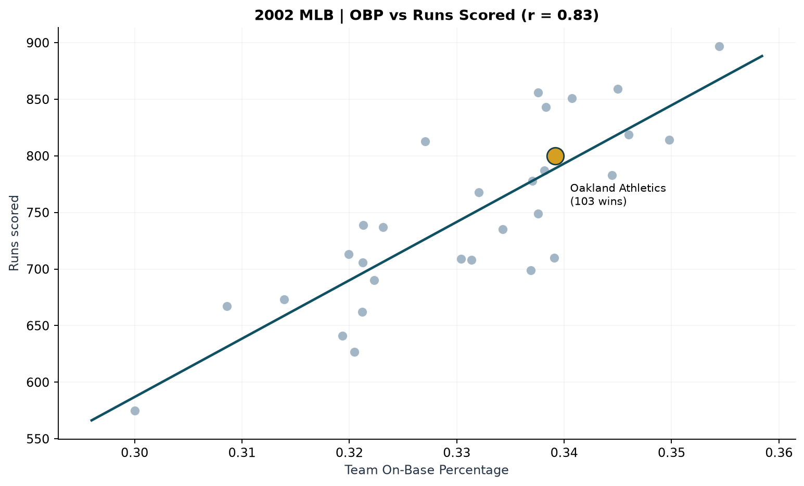
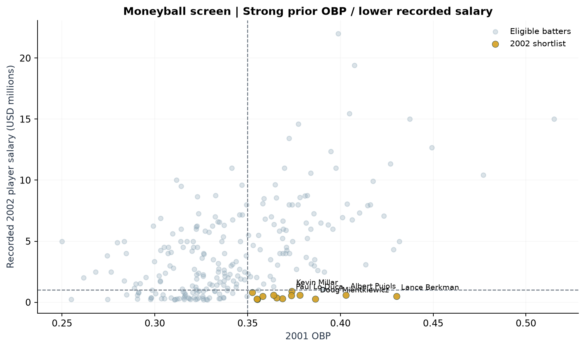
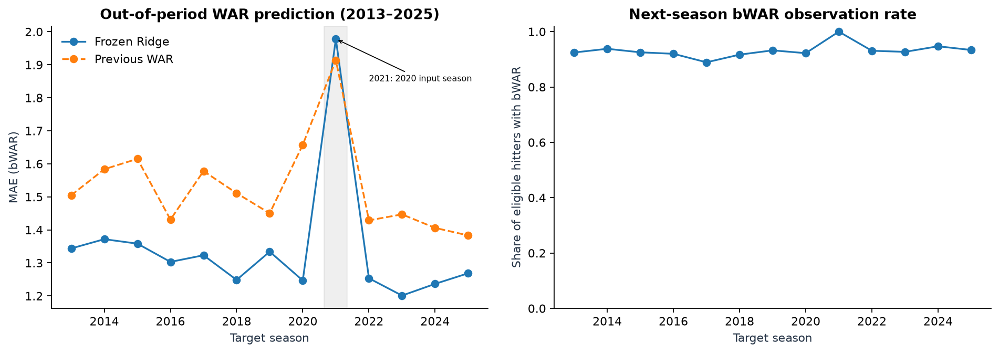
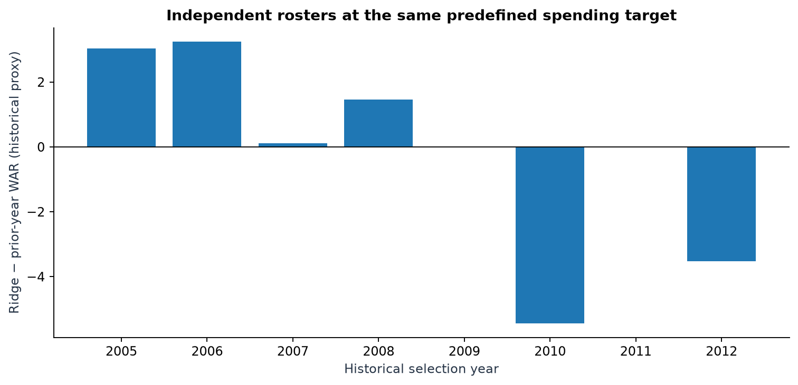
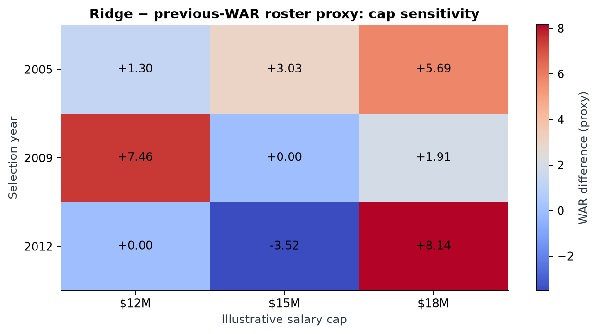
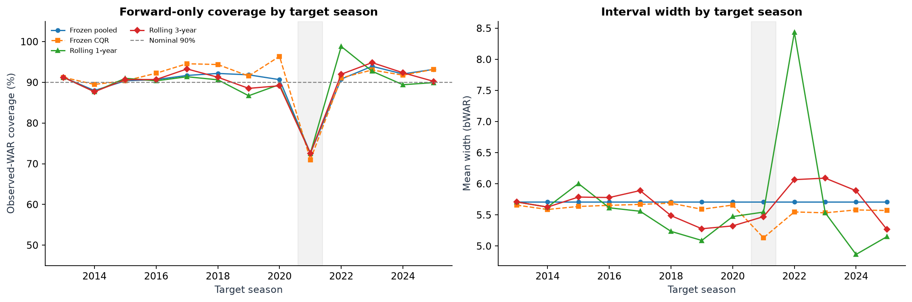

# ⚾ Moneyball Analysis: MLB Player Valuation, WAR Prediction & Roster Optimization

## Project Overview

This project explores how historical MLB data can be used to evaluate player performance, identify potentially undervalued players, predict future performance, and build hypothetical rosters under budget and positional constraints.

The original project focused on traditional Moneyball metrics, player similarity, and team chemistry.

I later revisited and expanded the analysis to include machine learning, WAR prediction, model validation, uncertainty estimation, and roster optimization.

The main question behind the extended research was:

**Does predicting player performance more accurately actually lead to better roster decisions?**

One of the key findings was that a model with lower prediction errors did not always produce a roster with better realized performance.

The project connects predictive modeling with constrained decision-making, while also examining the limitations of historical baseball data.

---

## Research Questions

### Original Research

**RQ1 — Moneyball Metrics**

Do traditional Moneyball metrics, particularly on-base percentage (OBP), remain useful for evaluating offensive performance and salary efficiency?

**RQ2 — Player Similarity**

Can Multidimensional Scaling (MDS) and clustering identify players with similar offensive profiles but different salaries?

**RQ3 — Team Chemistry and Experience**

How are team experience, player connections, and team performance related?

### Extended Research

**RQ4 — Player Performance Prediction**

How accurately can machine learning models predict future OBP and WAR compared with simpler historical baselines?

**RQ5 — Roster Optimization**

Can predicted player performance be used to construct competitive hypothetical rosters under salary and positional constraints?

**RQ6 — Prediction vs. Decision Quality**

Does a model with better predictive accuracy necessarily produce better realized roster outcomes?

**RQ7 — Robustness and Uncertainty**

How sensitive are the results to budgets, positional eligibility, missing performance data, and prediction uncertainty?

---

## Data Sources

The analysis uses historical MLB datasets covering player performance, salaries, team statistics, defensive appearances, and WAR.

Sources used in the research include:

- Lahman Baseball Database
- Historical player and team salary records
- Baseball-Reference WAR data
- Retrosheet play-by-play data

The local research dataset includes files such as:

- `Batting.csv`
- `Pitching.csv`
- `Fielding.csv`
- `Appearances.csv`
- `Teams.csv`
- `Salaries.csv`
- `Master.csv`
- `People.csv`
- `WAR.csv`
- `plays.csv`

Some historical and updated data snapshots use different file names or year coverage.

**Data availability:** The original large datasets are not included in this repository. The data must be obtained separately and placed in the configured local data directory.

A complete independent verification of every source file and its publisher version has not yet been completed.

---

## Methods and Analysis

### 1. Exploratory Baseball Analytics

The original research examined:

- Team OBP and runs scored
- Payroll efficiency and team wins
- Player salary and offensive performance
- Potentially undervalued players
- Team experience and performance

The 2002 MLB season was used as an important historical reference point for the Moneyball analysis.

### 2. Player Similarity and Clustering

Players were compared using offensive statistics such as:

- OBP
- Slugging percentage (SLG)
- Isolated power (ISO)
- Walk rate
- Other standardized batting features

Methods included K-Means clustering and Multidimensional Scaling (MDS).

The goal was to identify players with similar statistical profiles and examine differences in their recorded salaries.

### 3. Team Chemistry and Experience

The original team project also explored:

- Player connections based on shared team experience
- Team chemistry indices
- Network graph analysis
- Team age and experience
- Relationships with winning percentage

These analyses were exploratory and do not establish that team chemistry or experience directly causes better performance.

### 4. Machine Learning for Player Performance

The extended research compared several approaches for predicting future player performance.

Methods included:

- Ridge Regression
- ElasticNet
- Random Forest
- Gradient Boosting
- Learning-to-rank methods
- Empirical Bayes approaches
- Kalman-based models
- Two-part performance models

Model evaluation included season-based testing, walk-forward analysis, and comparisons with historical baselines.

### 5. WAR Prediction and Model Validation

A major part of the extended project focused on predicting future WAR.

For player-seasons with observed future WAR during the 2013–2025 evaluation period:

| Model | MAE | RMSE |
|---|---:|---:|
| Ridge Regression | **1.3112** | **1.6915** |
| Previous-Season WAR Baseline | 1.5115 | 1.9580 |

Ridge produced lower prediction errors in this observed evaluation sample.

However, future WAR was observed for 4,061 of 4,377 eligible player-seasons. The missing outcomes create an important evaluation limitation.

The historical evaluation period was also revisited during project development, so these results should not be presented as performance on a completely untouched final holdout.

### 6. Roster Optimization

I used mathematical optimization to construct hypothetical MLB rosters under constraints involving:

- Total salary budget
- Player selection
- Positional requirements
- Player eligibility
- Predicted player value

The optimization experiments compared rosters based on Ridge predictions with rosters based on previous-season WAR.

The purpose was to test whether improvements in individual player predictions translated into better team-level outcomes.

### 7. Budget and Positional Sensitivity

I also tested how roster outcomes changed under different assumptions.

These experiments included:

- Multiple budget levels
- Alternative positional eligibility thresholds
- Single-position versus multi-position roster construction
- Different designated hitter (DH) eligibility policies
- Player selection changes across scenarios
- Alternative near-optimal rosters

The positional sensitivity research included 144 optimization scenarios across eight historical seasons.

These are repeated scenarios based on the same seasons, not 144 independent historical observations.

### 8. Model Uncertainty and Robustness

Beyond point predictions, the extended research examined:

- Quantile and conformal prediction intervals
- Prediction interval coverage across seasons
- Missing WAR sensitivity
- Changes in model performance over time
- Season-level statistical comparisons
- Uncertainty in roster outcomes

These analyses helped identify situations where apparently strong model performance did not necessarily remain stable across different conditions.

---

## Key Findings

### 1. Ridge Improved WAR Prediction Accuracy

Ridge Regression produced lower MAE and RMSE than the previous-season WAR baseline among players with observed future outcomes.

### 2. Better Predictions Did Not Always Produce Better Rosters

Improved player-level prediction accuracy did not consistently translate into higher realized roster WAR.

In the historical roster experiments, results varied across seasons and budget settings.

This was one of the most interesting findings from the project.

### 3. Budget Constraints Affected Roster Outcomes

Changing the available budget sometimes changed both the selected players and the relative performance of the prediction strategies.

A model that performed better under one budget did not necessarily perform better under another.

### 4. Positional Flexibility Affected Player Selection

Allowing players to fill multiple positions sometimes changed roster composition and realized WAR.

The effect was not consistent across all seasons.

### 5. Prediction Uncertainty Mattered

Prediction intervals and missing performance data introduced additional uncertainty into player valuation.

Some evaluation periods showed weaker interval coverage, highlighting the importance of testing model reliability over time.

### 6. Predictive Accuracy and Decision Quality Are Different Problems

The main takeaway from the extended research is:

**A more accurate prediction model does not automatically lead to a better decision.**

Salary constraints, positional eligibility, candidate availability, and uncertain future outcomes also influence roster performance.

---

## Selected Visualizations

The following charts highlight the main stages of the research, from traditional Moneyball analysis to WAR prediction and roster optimization.

### 1. OBP and Run Production

I examined the relationship between on-base percentage and run production to understand why OBP became an important metric in the Moneyball approach.

### 2. Identifying Potentially Undervalued Players

I compared player performance and recorded salaries to identify players who appeared relatively inexpensive based on their offensive statistics.

These were historical value candidates, not necessarily players available for acquisition.

### 3. WAR Prediction: Ridge vs. Historical Baseline

Ridge Regression produced lower WAR prediction errors than a baseline using previous-season WAR for players with observed outcomes during 2013–2025.

This raised another question: would better predictions also lead to better roster outcomes?

### 4. Does Better Prediction Lead to Better Rosters?

I compared hypothetical rosters built using Ridge predictions and previous-season WAR under similar spending constraints.

Despite better individual prediction accuracy, Ridge-based rosters did not consistently achieve higher realized WAR.

### 5. Budget Sensitivity Analysis

I tested how different budget levels affected roster selection and performance.

The results showed that the relative performance of the strategies could change depending on the available budget.

### 6. Prediction Uncertainty Over Time

I also examined prediction interval reliability across seasons.

Coverage varied over time, highlighting the importance of evaluating uncertainty rather than relying only on point predictions.

### Additional Visualizations

The complete collection of research charts is available in the [visuals directory](visuals/).

Additional figures cover payroll efficiency, player similarity, model comparisons, missing WAR sensitivity, positional constraints, and alternative roster strategies.

---

## Repository Structure

The GitHub-ready project is organized into the following directories:

- **`notebooks/`** — Main research notebook and full technical analysis
- **`visuals/`** — Selected charts and research figures
- **`scripts/`** — Data provenance, validation, and supporting utilities
- **`tests/`** — Automated tests for data and optimization logic
- **`docs/`** — Methodology, execution instructions, and validation reports
- **`evidence/`** — Available research result summaries
- **`provenance/`** — Data source and integrity documentation
- **`data/`** — Local input-data location and preparation instructions
- **`.github/workflows/`** — Automated repository checks

### Main Notebooks

**`notebooks/01_Moneyball_Main_Research.ipynb`**

A shorter overview of the research questions, main analytical results, and conclusions.

**`notebooks/02_Moneyball_Full_Technical.ipynb`**

The detailed research notebook containing data preparation, statistical analyses, prediction models, roster optimization, sensitivity tests, and validation procedures.

The full technical notebook is intended as a research and implementation reference.

---

## How to Run

### 1. Clone the Repository

Clone or download this repository to your computer.

### 2. Install Python Dependencies

Use a virtual environment and install the packages listed in `requirements.txt`.

For example:

`python -m pip install -r requirements.txt`

### 3. Prepare the Datasets

Obtain the required MLB datasets separately and store them in your local data directory.

The notebook requires a valid data path before the raw data can be loaded.

Set the `DATA_DIR` configuration in the notebook to the folder containing the source CSV files.

Data files should not be committed to the public repository unless redistribution is permitted.

### 4. Open the Notebooks

Start JupyterLab or Jupyter Notebook and open the notebooks in the `notebooks/` directory.

The main notebook provides the shorter research overview.

The full technical notebook contains the detailed analysis and may require additional historical datasets and substantial computing resources.

### 5. Run Validation Checks

The repository includes automated checks for selected data, optimization, and reproducibility conditions.

Passing synthetic tests verifies aspects of code behavior, but it does not establish that the complete MLB research pipeline has been independently reproduced.

Refer to the documentation for the current validation status.

---

## Limitations

This research uses historical data and hypothetical roster construction.

Important limitations include:

- Recorded target-year salaries do not establish that players were actually available to acquire at those prices.
- Historical candidate selection may depend on information that would not have been fully available before a season began.
- Missing future WAR observations can affect evaluation results.
- Repeated simulations across the same seasons are not independent observations.
- Stronger prediction accuracy does not establish a causal improvement in roster performance.
- Full independent reproduction using all original MLB data files remains incomplete.
- Some optional optimization replay, R-based validation, and independent future evaluation procedures remain pending.

For these reasons, the roster experiments should be interpreted as **historical simulations rather than reconstructions of actual MLB front-office decisions**.

---

## Conclusion

This project began as an exploration of Moneyball metrics and undervalued players.

The extended analysis moved beyond player evaluation to examine how predictions could be used to construct hypothetical rosters under real-world-style constraints.

One of the most useful lessons was that improving a prediction model is not the same as improving the decisions made with its predictions.

The project helped me better understand the relationship between predictive modeling, optimization, data limitations, and decision-making.

---

## Technologies

Python · Pandas · NumPy · Scikit-learn · SciPy · Jupyter Notebook · Matplotlib · Statistical Modeling · Mathematical Optimization · Baseball Analytics
